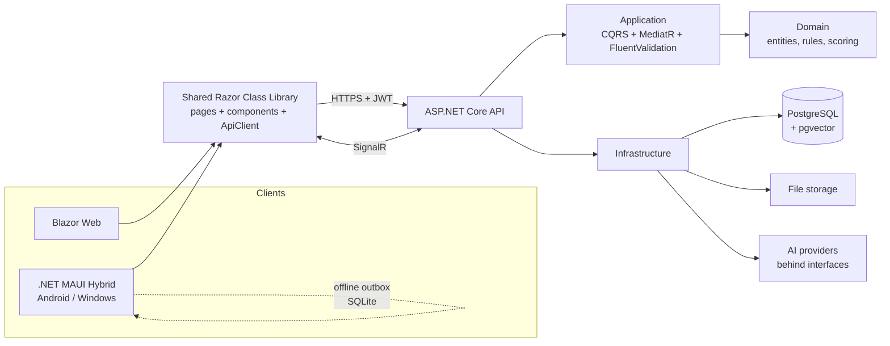
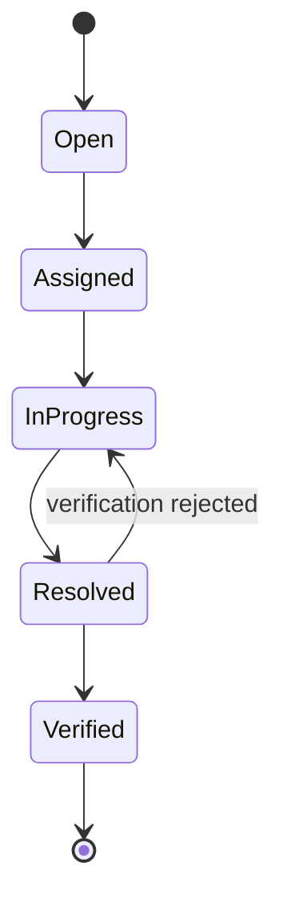

<div align="center">

# 🏭 GembaAudit

### Walk the floor. Find the problem. Fix it. Prove it.

**An offline-first, cross-platform 5S & occupational-safety audit platform, built with .NET 10, Clean Architecture and an AI layer that turns a site photo into an actionable finding.**


🇬🇧 English · [🇹🇷 Türkçe](README.tr.md)

<!-- Add after Phase 6: live demo link, CI badge, demo GIF -->
<!--  -->

</div>

---

## 💡 What is "Gemba"?

**Gemba (現場)** is a lean-manufacturing term meaning *"the real place where work happens"*: the factory floor, the warehouse, the construction site. The core idea behind 5S, Kaizen and modern safety culture is simple: **problems are only visible at the Gemba, so go and see them.**

GembaAudit digitizes exactly that walk. An auditor opens the app on a phone, scans a QR code at a work area, scores the checklist, photographs what is wrong, and the system makes sure someone fixes it, and that someone else verifies the fix.

## 🎯 The problem

In many plants and warehouses, audits still live in paper forms, Excel sheets and WhatsApp photos:

- Findings get lost between the audit and the fix
- Nobody knows who owns an action or when it is due
- Management sees a monthly summary, never the real-time picture
- The factory floor has weak or no connectivity, so "just use a web app" fails

GembaAudit is designed around those four failures.

## ✨ Features

> Status legend: ✅ done · 🚧 in progress · 🗓️ planned. The project is built in phases; see the [roadmap](#-roadmap).

### Audit & compliance
- 🗓️ **Configurable audit templates** for 5S (Seiri, Seiton, Seiso, Seiketsu, Shitsuke) and safety checklists, with weights, mandatory photos and versioning
- 🗓️ **Weighted scoring**: per-category and overall percentage, calculated in the domain layer and covered by unit tests
- 🗓️ **Audit lifecycle**: Draft → In Progress → Completed → Approved / Rejected, with manager sign-off
- 🗓️ **PDF audit reports** generated server-side

### Findings & corrective actions
- 🗓️ **Finding management** with severity, location, GPS, photos and threaded comments
- 🗓️ **Closed-loop workflow**: Open → Assigned → In Progress → Resolved → **Verified** (a different person must verify)
- 🗓️ **Due dates, ownership and notifications** so nothing silently ages

### Built for the shop floor
- 🗓️ **Cross-platform**: one C# codebase for Web, Android and Windows (Blazor + .NET MAUI Blazor Hybrid)
- 🗓️ **Offline-first**: audit with no signal; changes queue locally and sync when the network returns, with idempotent, conflict-aware sync
- 🗓️ **QR-code locations**: scan a code at the work area to start the right audit instantly
- 🗓️ **Camera & GPS** capture directly into findings
- 🗓️ **Real-time updates** with SignalR

### AI layer
- 🗓️ **Photo → finding suggestion**: take a photo, get a draft title, description, category and severity. A human always confirms; the AI never creates records on its own
- 🗓️ **Executive summaries** of audits and monthly trends
- 🗓️ **Ask your data (RAG)**: *"Which area had the most recurring housekeeping findings last quarter?"*, answered with links to the source findings (pgvector)
- 🗓️ **Risk prediction** (classic ML → ONNX) to flag findings likely to be reopened or overdue
- 🛡️ Provider-agnostic, PII masking, per-user quotas, and the app works fully with AI switched off

### Insights
- 🗓️ **Dashboard**: open findings, overdue actions, score trends, and hotspots by location (fast read-side queries with Dapper)

## 🏗️ Architecture

Clean Architecture with a strict dependency rule: **Domain ← Application ← Infrastructure ← Api**. Domain references nothing.



**Notable design decisions**

| Decision | Why |
|---|---|
| EF Core for writes, **Dapper for reads** | Rich domain model on the write side, fast hand-tuned SQL for dashboards and lists |
| Rich domain model with state-transition methods | Invalid transitions (e.g. verifying an unresolved finding) are impossible, not just validated |
| One shared Razor Class Library for Web and MAUI | Build the UI once; platform features sit behind interfaces |
| Client-generated `ClientId` for offline records | Safe retries: the same payload sent twice creates one record |
| AI behind interfaces, human-in-the-loop | Swappable providers, no hidden automation, graceful degradation |
| `SaveChangesInterceptor` for audit fields | Created/updated/deleted metadata is consistent for sync and async saves |

### Finding lifecycle



### Roles

| Role | What they can do |
|---|---|
| **Admin** | Manage users, locations and templates |
| **Manager** | Approve audits, assign actions, view all reports |
| **Auditor** | Run audits, raise findings |
| **Worker** | See and update the actions assigned to them |

## 🧰 Tech stack

| Area | Technology |
|---|---|
| Runtime | .NET 10 (LTS), C# |
| Backend | ASP.NET Core, MediatR 12.x, FluentValidation, EF Core, Dapper, Serilog |
| Database | PostgreSQL 16+, pgvector |
| Auth | JWT access tokens + rotating, hashed refresh tokens |
| Web UI | Blazor Web App, MudBlazor |
| Mobile / desktop | .NET MAUI Blazor Hybrid, SQLite (offline outbox) |
| Real-time | SignalR |
| Reports | QuestPDF |
| AI | Provider-agnostic (LLM + embeddings), ONNX Runtime for classic ML |
| Testing | xUnit, FluentAssertions, NSubstitute, Testcontainers, WebApplicationFactory |
| DevOps | Docker, docker-compose, GitHub Actions, GHCR |

## 🔐 Security by design

- JWT with short-lived access tokens, hashed and rotated refresh tokens, login rate limiting
- Role-based authorization enforced **in the API** (UI hiding is cosmetic only)
- Parameterized SQL only; no string-built queries
- File uploads validated by **magic bytes**, not just `Content-Type`; server-generated filenames, path-traversal protection, storage outside the web root
- Secrets only via environment variables; only `.env.example` is committed
- PII masked before any data is sent to an LLM; per-user AI quotas
- RFC 7807 `ProblemDetails` errors with no stack-trace leakage

## 🚀 Getting started

> ⚠️ **Nothing to run yet.** The project is at the planning stage and no phase has been implemented. These instructions describe the intended setup and will be verified and updated as each phase ships (Docker arrives in Phase 6).

**Prerequisites:** .NET 10 SDK, Docker, Git.

```bash
git clone https://github.com/YOUR_USERNAME/GembaAudit.git
cd GembaAudit

# Available from Phase 6
cp .env.example .env
docker compose up --build
```

Run the tests:

```bash
dotnet test
```

## 📁 Project structure

```
GembaAudit/
├── src/
│   ├── GembaAudit.Domain/          # Entities, rules, scoring (no dependencies)
│   ├── GembaAudit.Application/     # CQRS handlers, validators, interfaces
│   ├── GembaAudit.Infrastructure/  # EF Core, Dapper, JWT, storage, PDF, AI
│   ├── GembaAudit.Api/             # Controllers, middleware, SignalR hubs
│   ├── GembaAudit.Contracts/       # Request/response DTOs
│   ├── GembaAudit.UI.Shared/       # Razor Class Library (pages + components)
│   ├── GembaAudit.Web/             # Blazor Web host
│   └── GembaAudit.Mobile/          # .NET MAUI Blazor Hybrid
├── tests/                          # Unit, integration, sync tests
├── docs/                           # Architecture, decisions, reviews
└── .github/workflows/              # CI/CD
```

## 🗺️ Roadmap

| Phase | Focus | Status |
|---|---|---|
| 0 | Solution skeleton, CI | 🗓️ |
| 1 | Domain model, state machines, scoring | 🗓️ |
| 2 | Application layer (CQRS, validation) | 🗓️ |
| 3 | Persistence (EF Core, Dapper, migrations, seed) | 🗓️ |
| 4 | REST API, JWT, authorization | 🗓️ |
| 5 | Blazor web UI | 🗓️ |
| 6 | Docker, CI/CD, live demo | 🗓️ |
| 7 | MAUI app, QR, camera, **offline sync** | 🗓️ |
| 8 | AI: photo suggestions, summaries, RAG | 🗓️ |
| 9 | Classic ML risk prediction (ONNX) | 🗓️ |
| 10 | Polish, docs, v1.0.0 | 🗓️ |

## 🤖 How this project is built

GembaAudit is developed with AI coding agents in a role-based workflow inside Google Antigravity (Conductor, domain, backend, frontend, mobile, DevOps, QA, AI, review and documentation roles), working from a single [roadmap](GembaAudit-Roadmap.md) and a shared [`AGENTS.md`](AGENTS.md). Phases are executed in order, every phase passes an independent QA and security review, and a human approves each phase gate. Roles, ownership boundaries and rules live in the repository.

## 🧪 Quality bar

- Domain logic covered by unit tests (target ≥ 85%)
- Integration tests against real PostgreSQL via Testcontainers
- Sync idempotency tests (the same payload twice → one record)
- Warnings treated as errors; CI must be green before any phase closes

## 🤝 Contributing

Issues and ideas are welcome. Please open an issue before large changes. Contribution guidelines will be added once the first stable release is out.

## 📄 License

MIT. See [LICENSE](LICENSE) (added in Phase 10).

## 👤 Author

**YOUR NAME**: .NET full-stack developer with experience building enterprise ERP/BPM modules (5S field tours, occupational safety, business-process workflows) for large manufacturing and financial organizations.
[LinkedIn](https://www.linkedin.com/in/YOUR_PROFILE) · [GitHub](https://github.com/YOUR_USERNAME)

---

<div align="center">

*Built from real shop-floor domain experience. Go to the Gemba.* 🏭

</div>
