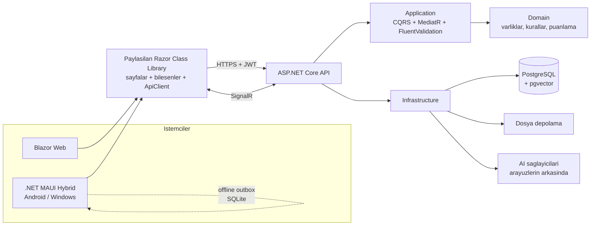
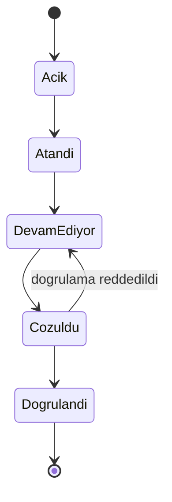

<div align="center">

# 🏭 GembaAudit

### Sahaya in. Sorunu bul. Çöz. Kanıtla.

**.NET 10, Clean Architecture ve saha fotoğrafını uygulanabilir bir uygunsuzluk kaydına çeviren bir yapay zekâ katmanıyla geliştirilen, çevrimdışı çalışabilen, çok platformlu 5S ve İş Sağlığı Güvenliği (İSG) denetim platformu.**


[](https://github.com/YOUR_USERNAME/GembaAudit/actions/workflows/ci.yml)


[🇬🇧 English](README.md) · 🇹🇷 Türkçe

<!-- Faz 6 sonrası: canlı demo bağlantısı, CI rozeti, demo GIF'i -->
<!--  -->

</div>

---

## 💡 "Gemba" ne demek?

**Gemba (現場)**, yalın üretim (lean) kültüründen gelen ve *"işin gerçekte yapıldığı yer"* anlamına gelen bir terimdir: üretim hattı, depo, şantiye. 5S, Kaizen ve modern iş güvenliği kültürünün temel fikri basittir: **sorunlar yalnızca Gemba'da görünür, o yüzden gidip yerinde görmek gerekir.**

GembaAudit tam olarak bu sahada yürüyüşü dijitalleştirir. Denetçi telefonunda uygulamayı açar, çalışma alanındaki QR kodu okutur, kontrol listesini puanlar, sorunu fotoğraflar. Sistem de bir kişinin sorunu düzeltmesini, başka bir kişinin de düzeltmeyi doğrulamasını sağlar.

## 🎯 Çözdüğü problem

Birçok fabrika ve depoda denetimler hâlâ kâğıt formlarda, Excel tablolarında ve WhatsApp fotoğraflarında yaşıyor:

- Uygunsuzluklar denetim ile düzeltme arasında kayboluyor
- Aksiyonun sahibi ve son tarihi belli olmuyor
- Yönetim gerçek zamanlı tabloyu değil, aylık özeti görüyor
- Sahada internet zayıf ya da hiç yok, "web uygulaması kullanın" çözümü işe yaramıyor

GembaAudit bu dört soruna göre tasarlandı.

## ✨ Özellikler

> Durum göstergesi: ✅ tamamlandı · 🚧 devam ediyor · 🗓️ planlandı. Proje fazlar hâlinde geliştiriliyor, [yol haritasına](#-yol-haritası) bakabilirsiniz.

### Denetim ve uygunluk
- 🗓️ **Yapılandırılabilir denetim şablonları**: 5S (Seiri, Seiton, Seiso, Seiketsu, Shitsuke) ve İSG kontrol listeleri; ağırlık, zorunlu fotoğraf ve sürüm desteğiyle
- 🗓️ **Ağırlıklı puanlama**: kategori ve genel yüzde, domain katmanında hesaplanır ve unit testlerle doğrulanır
- 🗓️ **Denetim yaşam döngüsü**: Taslak → Devam Ediyor → Tamamlandı → Onaylandı / Reddedildi, yönetici onayıyla
- 🗓️ **Sunucu tarafında PDF denetim raporları**

### Uygunsuzluk ve düzeltici aksiyonlar
- 🗓️ **Uygunsuzluk yönetimi**: ciddiyet, lokasyon, GPS, fotoğraf ve yorum akışı
- 🗓️ **Kapalı döngü iş akışı**: Açık → Atandı → Devam Ediyor → Çözüldü → **Doğrulandı** (doğrulamayı başka biri yapar)
- 🗓️ **Son tarih, sorumluluk ve bildirimler** sayesinde hiçbir kayıt sessizce eskimez

### Sahaya göre tasarlandı
- 🗓️ **Çok platformlu**: Web, Android ve Windows için tek C# kod tabanı (Blazor + .NET MAUI Blazor Hybrid)
- 🗓️ **Offline-first**: sinyal olmadan denetim yapın; değişiklikler cihazda sıraya girer, bağlantı gelince çakışmaya dayanıklı ve tekrar gönderime karşı güvenli (idempotent) şekilde senkronize olur
- 🗓️ **QR kodlu lokasyonlar**: çalışma alanındaki kodu okutarak doğru denetimi anında başlatın
- 🗓️ **Kamera ve GPS** ile doğrudan uygunsuzluk kaydına veri girişi
- 🗓️ **SignalR ile gerçek zamanlı** güncellemeler

### Yapay zekâ katmanı
- 🗓️ **Fotoğraftan uygunsuzluk önerisi**: fotoğraf çekin, başlık, açıklama, kategori ve ciddiyet taslağı alın. Son söz her zaman insandadır; yapay zekâ kendi başına kayıt oluşturmaz
- 🗓️ **Yönetici özetleri**: denetim ve aylık trend özetleri
- 🗓️ **Verinizle konuşun (RAG)**: *"Geçen çeyrekte en çok tekrar eden düzen-temizlik uygunsuzluğu hangi alandaydı?"* sorusuna kaynak kayıtlara bağlantılarla cevap (pgvector)
- 🗓️ **Risk tahmini** (klasik ML → ONNX): yeniden açılma veya gecikme olasılığı yüksek kayıtları işaretler
- 🛡️ Sağlayıcıdan bağımsız, kişisel veri maskeleme, kullanıcı başına kota; yapay zekâ kapalıyken uygulama tam çalışır

### Analiz
- 🗓️ **Dashboard**: açık uygunsuzluklar, geciken aksiyonlar, skor trendleri ve lokasyon bazlı sıcak noktalar (Dapper ile hızlı okuma sorguları)

## 🏗️ Mimari

Katı bir bağımlılık kuralıyla Clean Architecture: **Domain ← Application ← Infrastructure ← Api**. Domain hiçbir projeye bağımlı değildir.



**Öne çıkan tasarım kararları**

| Karar | Neden |
|---|---|
| Yazmada EF Core, **okumada Dapper** | Yazma tarafında zengin domain modeli, dashboard ve listelerde hızlı, elle ayarlanmış SQL |
| Durum geçiş metotlarıyla zengin domain modeli | Geçersiz geçişler (örn. çözülmemiş kaydı doğrulamak) sadece doğrulanmaz, mümkün de olmaz |
| Web ve MAUI için tek paylaşılan Razor Class Library | Arayüz bir kez yazılır; platform özellikleri arayüzlerin arkasında kalır |
| Offline kayıtlar için istemci üretimli `ClientId` | Güvenli tekrar deneme: aynı veri iki kez gelse bile tek kayıt oluşur |
| Arayüzlerin arkasında AI, insan onaylı | Değiştirilebilir sağlayıcı, gizli otomasyon yok, kontrollü devre dışı kalma |
| Audit alanları için `SaveChangesInterceptor` | Oluşturma/güncelleme/silme bilgileri senkron ve asenkron kayıtta tutarlı |

### Uygunsuzluk yaşam döngüsü



### Roller

| Rol | Yapabilecekleri |
|---|---|
| **Admin** | Kullanıcı, lokasyon ve şablon yönetimi |
| **Manager** | Denetim onayı, aksiyon atama, tüm raporları görme |
| **Auditor** | Denetim yapma, uygunsuzluk açma |
| **Worker** | Kendisine atanan aksiyonları görme ve güncelleme |

## 🧰 Teknoloji yığını

| Alan | Teknoloji |
|---|---|
| Çalışma ortamı | .NET 10 (LTS), C# |
| Backend | ASP.NET Core, MediatR 12.x, FluentValidation, EF Core, Dapper, Serilog |
| Veritabanı | PostgreSQL 16+, pgvector |
| Kimlik doğrulama | JWT erişim token'ı + döndürülen (rotation), hash'li refresh token'lar |
| Web arayüzü | Blazor Web App, MudBlazor |
| Mobil / masaüstü | .NET MAUI Blazor Hybrid, SQLite (offline outbox) |
| Gerçek zamanlı | SignalR |
| Raporlama | QuestPDF |
| AI | Sağlayıcıdan bağımsız (LLM + embedding), klasik ML için ONNX Runtime |
| Test | xUnit, FluentAssertions, NSubstitute, Testcontainers, WebApplicationFactory |
| DevOps | Docker, docker-compose, GitHub Actions, GHCR |

## 🔐 Tasarımdan gelen güvenlik

- Kısa ömürlü erişim token'ları, hash'li ve döndürülen refresh token'lar, giriş denemesi sınırlaması (rate limiting)
- Rol bazlı yetkilendirme **API'de** uygulanır (arayüzde gizleme yalnızca görsel kolaylıktır)
- Yalnızca parametreli SQL; string birleştirmeyle sorgu yok
- Dosya yüklemeleri yalnızca `Content-Type`'a değil **magic bytes**'a göre doğrulanır; sunucu tarafında üretilen dosya adları, path traversal koruması, web root dışında depolama
- Gizli bilgiler yalnızca ortam değişkenleriyle; repoda yalnızca `.env.example` bulunur
- Herhangi bir LLM'e veri gönderilmeden önce kişisel veriler maskelenir; kullanıcı başına AI kotası
- Yığın izi (stack trace) sızdırmayan RFC 7807 `ProblemDetails` hata formatı

## 🚀 Başlarken

> ⚠️ **Henüz çalıştırılacak bir şey yok.** Proje planlama aşamasındadır ve hiçbir faz uygulanmamıştır. Bu adımlar hedeflenen kurulumu anlatır; her faz tamamlandıkça doğrulanıp güncellenecek (Docker Faz 6'da gelecek).

**Gereksinimler:** .NET 10 SDK, Docker, Git.

```bash
git clone https://github.com/YOUR_USERNAME/GembaAudit.git
cd GembaAudit

# Faz 6'dan itibaren kullanılabilir
cp .env.example .env
docker compose up --build
```

Testleri çalıştırmak için:

```bash
dotnet test
```

## 📁 Proje yapısı

```
GembaAudit/
├── src/
│   ├── GembaAudit.Domain/          # Varlıklar, kurallar, puanlama (bağımlılık yok)
│   ├── GembaAudit.Application/     # CQRS handler'ları, validator'lar, arayüzler
│   ├── GembaAudit.Infrastructure/  # EF Core, Dapper, JWT, depolama, PDF, AI
│   ├── GembaAudit.Api/             # Controller'lar, middleware, SignalR hub'ları
│   ├── GembaAudit.Contracts/       # İstek/yanıt DTO'ları
│   ├── GembaAudit.UI.Shared/       # Razor Class Library (sayfalar + bileşenler)
│   ├── GembaAudit.Web/             # Blazor Web host
│   └── GembaAudit.Mobile/          # .NET MAUI Blazor Hybrid
├── tests/                          # Unit, entegrasyon ve senkronizasyon testleri
├── docs/                           # Mimari, kararlar, incelemeler
└── .github/workflows/              # CI/CD
```

## 🗺️ Yol haritası

| Faz | Odak | Durum |
|---|---|---|
| 0 | Çözüm iskeleti, CI | 🚧 |
| 1 | Domain modeli, durum makineleri, puanlama | 🗓️ |
| 2 | Application katmanı (CQRS, doğrulama) | 🗓️ |
| 3 | Kalıcılık (EF Core, Dapper, migration, seed) | 🗓️ |
| 4 | REST API, JWT, yetkilendirme | 🗓️ |
| 5 | Blazor web arayüzü | 🗓️ |
| 6 | Docker, CI/CD, canlı demo | 🗓️ |
| 7 | MAUI uygulaması, QR, kamera, **offline senkronizasyon** | 🗓️ |
| 8 | AI: fotoğraf önerisi, özetler, RAG | 🗓️ |
| 9 | Klasik ML ile risk tahmini (ONNX) | 🗓️ |
| 10 | Cila, dokümantasyon, v1.0.0 | 🗓️ |

## 🤖 Bu proje nasıl geliştiriliyor?

GembaAudit, Google Antigravity içinde rol tabanlı bir iş akışıyla yapay zekâ kodlama ajanlarıyla geliştiriliyor (Conductor; domain, backend, frontend, mobil, DevOps, QA, AI, inceleme ve dokümantasyon rolleri). Tek bir [yol haritası](GembaAudit-Roadmap.md) ve ortak bir [`AGENTS.md`](AGENTS.md) esas alınır. Fazlar sırayla yürütülür, her faz bağımsız bir QA ve güvenlik incelemesinden geçer ve her faz geçişini bir insan onaylar. Roller, sahiplik sınırları ve kurallar repoda yer alır.

## 🧪 Kalite çıtası

- Domain mantığı unit testlerle kapsanır (hedef ≥ %85)
- Testcontainers ile gerçek PostgreSQL üzerinde entegrasyon testleri
- Senkronizasyon idempotency testleri (aynı veri iki kez → tek kayıt)
- Uyarılar hata sayılır; bir faz kapanmadan CI yeşil olmalıdır

## 🤝 Katkı

Issue ve fikirlere açığız. Büyük değişikliklerden önce lütfen bir issue açın. Katkı kuralları ilk kararlı sürümden sonra eklenecek.

## 📄 Lisans

MIT. Bkz. [LICENSE](LICENSE) (Faz 10'da eklenecek).

## 👤 Geliştirici

**ADINIZ SOYADINIZ**: Büyük üretim ve finans kuruluşları için kurumsal ERP/BPM modülleri (5S saha turu, iş güvenliği, iş süreci akışları) geliştirmiş .NET full-stack geliştirici.
[LinkedIn](https://www.linkedin.com/in/PROFIL_ADINIZ) · [GitHub](https://github.com/YOUR_USERNAME)

---

<div align="center">

*Gerçek saha tecrübesinden doğdu. Gemba'ya git.* 🏭

</div>
